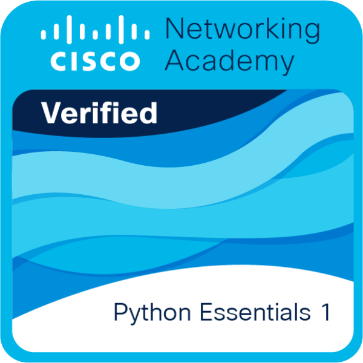
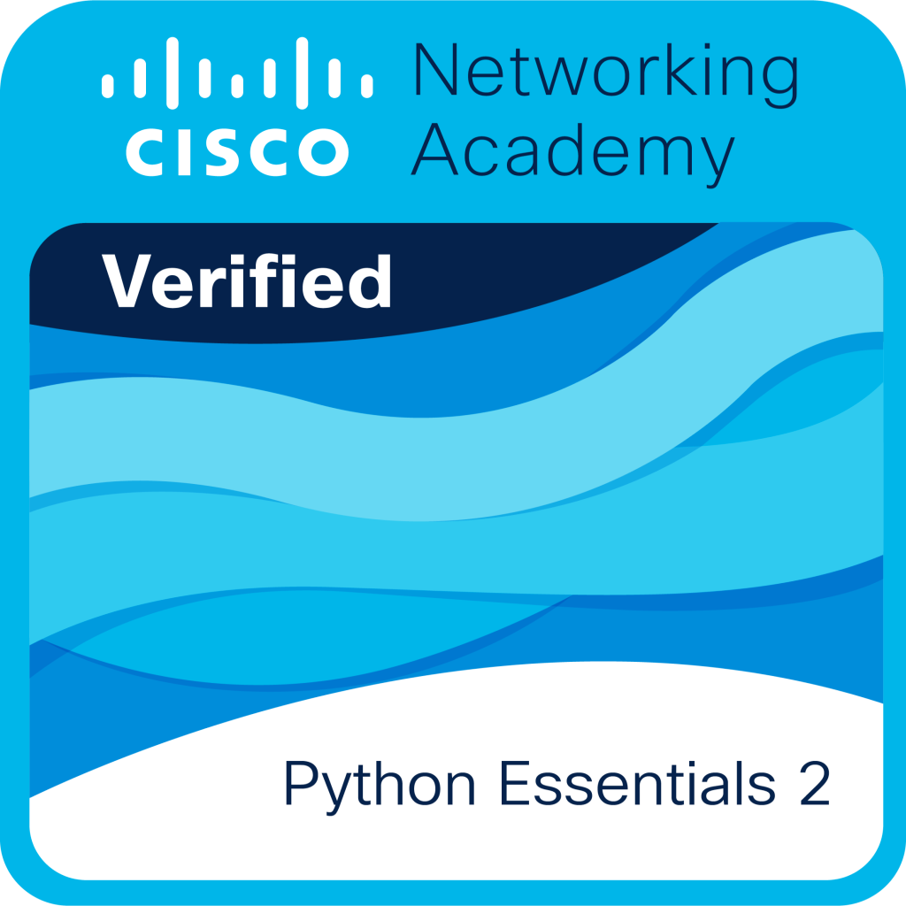
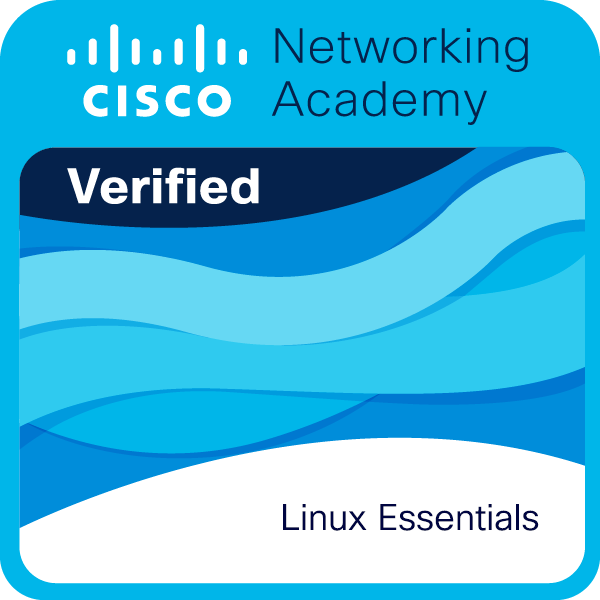
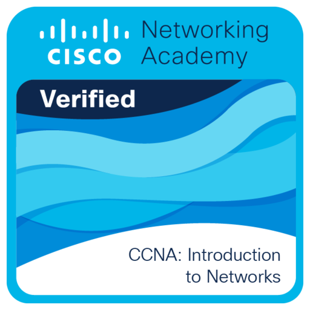

<h1 align="center">Hi, I'm Abdulaziz</h1>

<h3 align="center">
Computer & Network Engineering Student @ Jazan University
</h3>

<p align="center">

</p>

<p align="center">
  <a href="https://www.linkedin.com/in/abdulaziz-mashnawi-726a68275">
    
  </a>
  <a href="mailto:abdulazizmashnawi@gmail.com">
    
  </a>
  
</p>

<br>

## About Me

```console
[abdulaziz@linux ~]$ cat about_me.txt
> Studying: Computer & Network Engineering @ Jazan University
> Building: 3-tier campus network (OSPFv2/v3, VLANs, NAT) & E2EE chat simulator
> Practicing: Linux administration, Bash automation, relational schema design in SQL
> Next targets: CCNA 200-301, then AWS Solutions Architect & Cisco DevNet
> Member: Saudi Council of Engineers (SCE) — Student Member
```

<br>

## Featured Projects

<table align="center">
  <tr>
    <td align="center" width="50%" valign="top">
      <a href="https://github.com/AbdulazizMashnawi-NET/Smart-University-Network-Design">
        
      </a>
      <br>
      <sub>3-tier campus network (Core/Distribution/Access): OSPFv2 + OSPFv3 dual-stack, VLANs &amp; 802.1Q, DHCP relay + IPv6 SLAAC, NAT, IoT server — Cisco Packet Tracer.</sub>
    </td>
    <td align="center" width="50%" valign="top">
      <a href="https://github.com/AbdulazizMashnawi-NET/SecureChat-E2EE-Simulator">
        
      </a>
      <br>
      <sub>E2EE messaging simulator: RSA-2048/OAEP key exchange, AES-256-GCM, RSA-PSS signatures, MitM attack visualization — Flask + PyCryptodome.</sub>
    </td>
  </tr>
  <tr>
    <td align="center" width="50%" valign="top">
      <a href="https://github.com/AbdulazizMashnawi-NET/Jazan-Uni-SUC-Manager">
        
      </a>
      <br>
      <sub>Offline-first timetable planner: parses saved portal HTML, detects section conflicts, ranks schedules by free days, exports image — vanilla JS, no backend.</sub>
    </td>
    <td align="center" width="50%" valign="top">
      <a href="https://github.com/AbdulazizMashnawi-NET/Shipping-Company-Database">
        
      </a>
      <br>
      <sub>Database design exercise: ER model → relational schema (departments, employees, shipments, customers, dependents), DDL/DML and reporting queries.</sub>
    </td>
  </tr>
  <tr>
    <td align="center" colspan="2" valign="top">
      <a href="https://github.com/CNET463-Team-T01/zero-trust-hybrid-network-lab">
        
      </a>
      <br>
      <sub>Course team project (CNET-463, Team T01): NIST SP 800-207 assessment of a hybrid exam system — nftables micro-segmentation, PEP hardening, WireGuard scoping, verified with nmap/tcpdump. <b>My scope: Parts A &amp; B</b> (discovery, vulnerability assessment, host segmentation).</sub>
    </td>
  </tr>
</table>

<br>

## Core Engineering Domains

<table>
  <tr>
    <td width="50%" valign="top">
      <h3>Network Architecture & Protocols</h3>
      <ul>
        <li><b>3-Tier Design:</b> Core, Distribution, Access across 3 campus buildings</li>
        <li><b>Routing:</b> OSPFv2 (IPv4) &amp; OSPFv3 (IPv6) dual-stack on multilayer switches</li>
        <li><b>Switching:</b> VLAN segmentation &amp; 802.1Q trunking, inter-VLAN routing</li>
        <li><b>IP Services:</b> DHCP pools with IP-helper, IPv6 SLAAC, NAT at the edge</li>
        <li><b>Tooling:</b> Cisco Packet Tracer topologies, verification with show/ping/traceroute</li>
      </ul>
    </td>
    <td width="50%" valign="top">
      <h3>Security & Cryptography</h3>
      <ul>
        <li><b>E2EE:</b> RSA-2048/OAEP key exchange with AES-256-GCM payloads</li>
        <li><b>Signatures:</b> RSA-PSS sender authentication; MitM interception demo</li>
        <li><b>Zero Trust:</b> NIST SP 800-207 gap assessment, default-drop nftables rules</li>
        <li><b>Verification:</b> nmap before/after scans, tcpdump packet-level proof</li>
        <li><b>Network Security:</b> ACL-style rules, PEP policy checks, WireGuard scoping</li>
      </ul>
    </td>
  </tr>
  <tr>
    <td width="50%" valign="top">
      <h3>Linux Systems & Automation</h3>
      <ul>
        <li><b>Administration:</b> users &amp; groups, permissions, packages, services, logs</li>
        <li><b>Shell Scripting:</b> file handling, backup routines, repeatable task automation</li>
        <li><b>Python:</b> OOP, Flask endpoints, PyCryptodome for crypto prototypes</li>
        <li><b>Tooling:</b> Git/GitHub workflow, Docker Compose lab environments, Postman</li>
      </ul>
    </td>
    <td width="50%" valign="top">
      <h3>Database & Application Design</h3>
      <ul>
        <li><b>Modeling:</b> ER diagrams mapped to normalized relational schemas</li>
        <li><b>SQL:</b> DDL/DML, joins, subqueries, reporting queries on Oracle DB</li>
        <li><b>Web Apps:</b> offline-first HTML/CSS/JS with client-side parsing &amp; conflict detection</li>
        <li><b>Privacy by Design:</b> local data processing, no server-side storage</li>
      </ul>
    </td>
  </tr>
</table>

<br>

## Certifications & Credentials

**Verified course badges** (Cisco Networking Academy, via Credly):
<p align="left">
  <a href="https://www.credly.com/badges/a179547a-c579-40ab-8325-c3c371f5c499/public_url" target="_blank">
    
  </a>
  &nbsp;
  <a href="https://www.credly.com/badges/d649e012-a588-414b-be9f-fcbc4869978f/public_url" target="_blank">
    
  </a>
  &nbsp;
  <a href="https://www.credly.com/badges/a0877d18-18ce-4e9d-950b-34caed32699f/public_url" target="_blank">
    
  </a>
  &nbsp;
  <a href="https://www.credly.com/badges/74cd7984-f8cb-4439-814f-d6d1c7f206a4/public_url" target="_blank">
    
  </a>
</p>

<sub>These are course-completion badges, not professional certifications. CCNA 200-301 is my next exam target.</sub>

<br><br>

**Professional membership & next certifications:**
<p align="left">
  
  &nbsp;
  
  &nbsp;
  
  &nbsp;
  
</p>

<br>

## Tech Stack & Tooling

<table>
  <tr>
    <th align="center" width="33%">Languages &amp; Scripting</th>
    <th align="center" width="33%">Systems, Networking &amp; Tooling</th>
    <th align="center" width="33%">Databases &amp; Web</th>
  </tr>
  <tr>
    <td align="center" valign="top">
      <br>
      
      <br><br>
    </td>
    <td align="center" valign="top">
      <br>
      
      <br><br>
    </td>
    <td align="center" valign="top">
      <br>
      
      <br><br>
    </td>
  </tr>
</table>

<sub><b>Learning next:</b> AWS (Solutions Architect Associate track), Cisco DevNet automation.</sub>

<br>

## Top Languages

<div align="center">
  
</div>

<br>

## Contribution Graph

<div align="center">
  <picture>
    <source media="(prefers-color-scheme: dark)" srcset="https://raw.githubusercontent.com/AbdulazizMashnawi-NET/AbdulazizMashnawi-NET/output/github-contribution-grid-snake-dark.svg">
    <source media="(prefers-color-scheme: light)" srcset="https://raw.githubusercontent.com/AbdulazizMashnawi-NET/AbdulazizMashnawi-NET/output/github-contribution-grid-snake.svg">
    
  </picture>
</div>

<br>

<div align="center">
  
</div>

<p align="center">
Thanks for visiting my profile!
</p>
